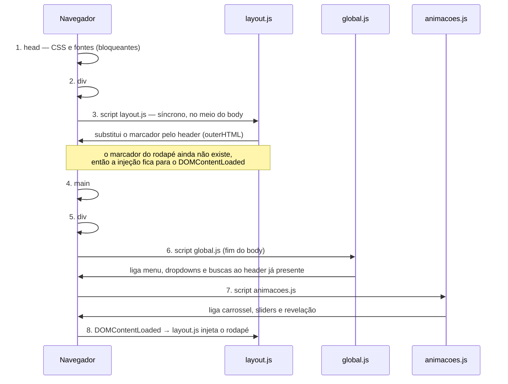

# Arquitetura

## 1. Princípios

Quatro restrições explicam quase todo o desenho do projeto:

1. **Sem build.** O que está no repositório é exatamente o que o navegador
   recebe. Não há bundler, transpilador, pré-processador de CSS nem
   `package.json`. Qualquer pessoa da equipe consegue abrir um arquivo, editar e
   ver o resultado atualizando a página.
2. **Sem servidor.** O GitHub Pages serve arquivos estáticos e não tem
   includes, templates nem backend. Tudo que precisa ser compartilhado entre
   páginas é compartilhado no navegador, por JavaScript, ou duplicado de
   propósito.
3. **Sem dependências de runtime.** Nenhuma biblioteca JS. A única dependência
   externa são as fontes do Google Fonts; a única dependência de
   desenvolvimento é o Pillow, usado apenas pelo script de imagens.
4. **O conteúdo é o HTML.** Não existe CMS, JSON de dados nem geração de
   páginas. Um jogo novo no acervo é um `<article>` novo no HTML.

Consequência prática: o custo de manutenção está em disciplina de convenções,
não em configuração de ferramentas. As convenções estão em
[paginas.md](paginas.md), [css.md](css.md) e [javascript.md](javascript.md).

## 2. Camadas

```
┌──────────────────────────────────────────────────────────────┐
│  Conteúdo         index.html, pages/*.html, 404.html         │
│                   Texto, estrutura semântica, marcação do    │
│                   acervo, metadados por página (SEO / OG)    │
├──────────────────────────────────────────────────────────────┤
│  Apresentação     css/global.css       tokens + reset        │
│                   css/componentes.css  componentes           │
├──────────────────────────────────────────────────────────────┤
│  Comportamento    js/layout.js     header/rodapé + menu      │
│                   js/global.js     navegação + buscas        │
│                   js/animacoes.js  carrossel + sliders       │
├──────────────────────────────────────────────────────────────┤
│  Mídia            assets/**  (apenas WebP)                   │
├──────────────────────────────────────────────────────────────┤
│  Entrega          GitHub Pages  ← push na branch main        │
│                   .nojekyll, robots.txt, sitemap.xml         │
└──────────────────────────────────────────────────────────────┘
```

As camadas são deliberadamente finas e de mão única: o CSS não conhece o
JavaScript, e o JavaScript só conhece o HTML através de um conjunto pequeno de
`id`s, classes e `data-*` documentados em [javascript.md](javascript.md).

## 3. Estrutura de arquivos

```
.
├── index.html                   Página inicial (hero, modelos, objetivos)
├── 404.html                     Erro — autossuficiente, com CSS e JS embutidos
├── .nojekyll                    Desliga o processamento Jekyll no GitHub Pages
├── robots.txt                   Libera indexação e aponta o sitemap
├── sitemap.xml                  11 URLs, mantido à mão
├── README.md                    Guia de uso e tarefas comuns
├── LICENSE
├── css/
│   ├── global.css               ~390 linhas — tokens, reset, tipografia, layout
│   └── componentes.css          ~1200 linhas — header, cards, sliders, rodapé
├── js/
│   ├── layout.js                Fonte única do menu; monta header e rodapé
│   ├── global.js                Menu mobile, dropdowns, busca de livros e jogos
│   └── animacoes.js             Carrossel 3D, sliders de cards, revelação
├── pages/                       10 páginas internas
│   ├── acervo.html              Como funciona o empréstimo (etapas, FAQ)
│   ├── jogos.html               60 jogos em 7 áreas, com busca e filtros
│   ├── livros.html              Acervo de livros, com busca
│   ├── o-lecc.html              Idealização, objetivos, linha do tempo
│   ├── equipe.html              Integrantes
│   ├── modelos-didaticos.html   ┐
│   ├── propostas-didaticas.html │ páginas "em preparação"
│   ├── noite-jogos.html         │ (mesmo molde, só o texto muda)
│   ├── leituras-lecc.html       │
│   └── projetos-extensao.html   ┘
├── assets/                      93 arquivos, ~4,7 MB, todos .webp
│   ├── icons/                   Logo e ícones (80 KB)
│   ├── equipe/                  Fotos da equipe (216 KB)
│   ├── imagens-jogos/           7 subpastas, uma por área (3,2 MB)
│   ├── imagens-lab/             Fotos do laboratório (948 KB)
│   ├── imagens-modelos/         Modelos didáticos (92 KB)
│   └── livros/                  Capas (160 KB)
└── scripts/
    └── otimizar-imagens.py      Converte assets/ para WebP e redimensiona
```

## 4. Ciclo de vida de uma página

A ordem das tags `<script>` é intencional e é o ponto mais sutil da
arquitetura.



Três pontos decorrem disso:

- **`layout.js` é carregado no corpo, logo abaixo do marcador do header**, e não
  no `<head>` nem com `defer`. Assim o cabeçalho entra no DOM antes de o resto
  da página ser pintado, e não há salto visual (nem uma faixa em branco onde o
  header deveria estar).
- **`global.js` e `animacoes.js` ficam no fim do `<body>`** e por isso já
  encontram o header montado. Essa dependência é de ordem, não de import: se
  alguém mover `layout.js` para o `<head>` com `defer`, o menu deixa de
  funcionar silenciosamente.
- **O rodapé é injetado em dois tempos.** `injetarQuandoPossivel()` tenta na
  hora e, se o marcador ainda não existe, registra um `DOMContentLoaded`.

## 5. Fonte única da navegação

O menu existe uma única vez, na constante `MENU` de
[`js/layout.js`](../js/layout.js):

```js
var MENU = [
    { rotulo: 'Início', href: 'index.html' },
    { rotulo: 'Acervo', id: 'drop-acervo', itens: [ /* … */ ] },
    { rotulo: 'Ações',  id: 'drop-acoes',  itens: [ /* … */ ] },
    { rotulo: 'O LECC', href: 'pages/o-lecc.html' },
    { rotulo: 'Nossa Equipe', href: 'pages/equipe.html' }
];
```

Uma entrada é um link (`href`) **ou** um dropdown (`id` + `itens`). O
`layout.js` deriva desse dado três coisas:

- **Caminhos relativos.** Todo `href` é escrito relativo à raiz do site. A
  função `prefixo()` devolve `'../'` quando a URL contém `/pages/` e `''` na
  raiz. Caminhos absolutos (`/css/...`) não servem porque o site de projeto do
  GitHub Pages fica em `usuario.github.io/repositorio/`.
- **Página atual.** `ehAtual()` compara o último segmento do `href` com o
  arquivo da URL e aplica `aria-current="page"` no link, além de
  `data-ativo="true"` no botão do dropdown que contém a página aberta.
- **Escape.** `escapar()` troca `&`, `<`, `>` e `"` nos rótulos antes de
  concatená-los no HTML.

O rodapé é montado no mesmo arquivo, com sua própria lista curta de links
rápidos, os contatos (`EMAIL`, `INSTAGRAM`, `NECBIO`) e o ano calculado em
tempo de execução.

**Exceção consciente:** o `<noscript>` de cada página tem uma lista de links
escrita à mão. Ela não vem do `MENU` — não poderia, já que existe justamente
para quem está sem JavaScript. Ver [limitacoes.md](limitacoes.md).

## 6. Dados e estado

Não há estado persistido, `localStorage` nem requisições de rede feitas pelo
site. Todo o "dado" do acervo é marcação:

| Coleção | Onde vive | Como é consultada |
| --- | --- | --- |
| 60 jogos | `pages/jogos.html`, em `<section class="grupo-area" data-area="…">` | busca por texto + chips de área, em `global.js` |
| Livros | `pages/livros.html`, em `.card-livro` | busca por texto, em `global.js` |
| Modelos | `index.html` e `pages/modelos-didaticos.html` | slider, em `animacoes.js` |
| Equipe | `pages/equipe.html`, em `.card-equipe` | — |

As buscas filtram com `elemento.hidden = true/false` sobre o `textContent` do
card, normalizado sem acentos (`normalizar()`), de modo que "generica" encontra
"Genética". Nada é removido do DOM e nada é reconstruído: o estado visível é só
um atributo.

## 7. Onde mexer para cada tipo de mudança

| Mudança | Arquivo |
| --- | --- |
| Item de menu, rodapé, e-mail, Instagram | `js/layout.js` apenas |
| Cor, espaçamento, fonte, raio, sombra | tokens no `:root` de `css/global.css` |
| Aparência de um componente | `css/componentes.css` |
| Texto ou item do acervo | o HTML da própria página |
| Comportamento de menu ou busca | `js/global.js` |
| Carrossel, slider, animação de entrada | `js/animacoes.js` |
| Página nova | copiar uma de `pages/` + registrar em `MENU` e `sitemap.xml` |
| Imagem nova | `assets/<pasta>/` + `python scripts/otimizar-imagens.py` |
